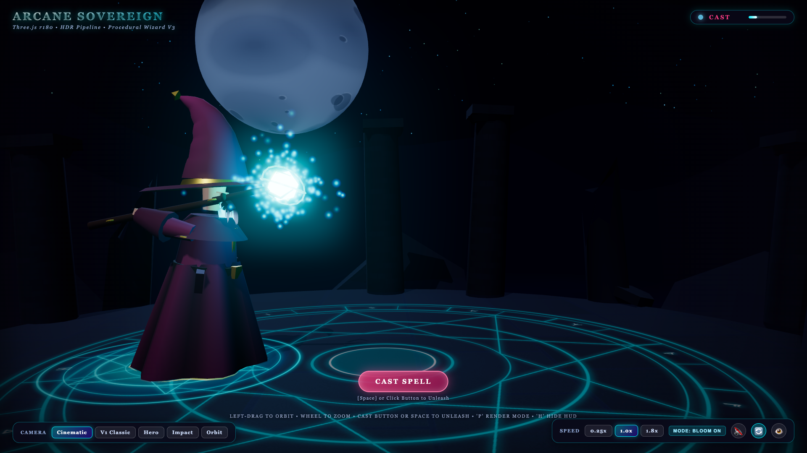

# The Wizard

A wizard charges up a spell and blasts a glowing rock. That's the whole plot. I'm Cricket ([@Cyb3rCricket](https://x.com/Cyb3rCricket)), and I kept making it fancier because it was fun.



## What's in here

| File | What it is |
| --- | --- |
| `wizard-v3.html` | The main event: a 3D wizard in Three.js with a charge-up, a projectile, an impact, bloom, a Cinematic or Classic look, and synthesized sound. |
| `wizard-v2.html` | The earlier 3D version. It's simpler, and kept for comparison. |
| `grok-4-7-test.html`, `gpt-6-astra-test.html`, `gemini-3-8-test.html` | A "same prompt, different model" bake-off. More on these below. |
| `screenshots/` | Captures from each version and pass. |
| `docs/` | The AI planning notes and the audit behind V3, plus the spec for a future hand-made 3D model. |
| `tools/` | Verification scripts and a validator for that future model file. |

## View it

Every page is a single HTML file. The 3D pages load Three.js from a CDN, so serve the folder and open a page:

```bash
python3 -m http.server 8000
```

Then open http://localhost:8000/wizard-v3.html. Press Space, or click the button, to cast. Sound starts muted, so use the speaker button to turn it on.

## How it works

- **V3** is one big HTML file. The wizard, the staff, the runes, and the rock are all built from code (no 3D model files), and the lighting, bloom, and sound are made right in the browser. It went through three planned passes. The plans and audit are in `docs/`.
- **The bake-off pages** are tiny pixel-art scenes. Each one draws a wizard casting a spell on a 128×96 canvas with a small fixed color palette, then scales it up so the pixels stay crisp. Each file was written by a different AI model from the same prompt:
  - `grok-4-7-test.html`: Grok 4.7 ("Pixel Wizard")
  - `gpt-6-astra-test.html`: GPT-6 Astra ("Moonlit Spell")
  - `gemini-3-8-test.html`: Gemini 3.8 ("Pixel Art Wizard")

  Open them side by side to see how differently three models read the same request. The exact prompt text isn't saved in this repo, and I didn't score them. They're here to look at, not as a benchmark.

## The honest catch

- `wizard-v3.html` is about 5,700 lines in one file. It works, but it's not a tidy codebase.
- The 3D pages need internet access for Three.js and a decent GPU.
- The verification scripts in `tools/` were written for my Mac: they expect Brave and Firefox at their macOS install paths. They're a record of how I checked each pass, not something you need to run.
- `docs/` describes a future hand-made 3D wizard model that doesn't exist yet. The code-built wizard is the real one.
